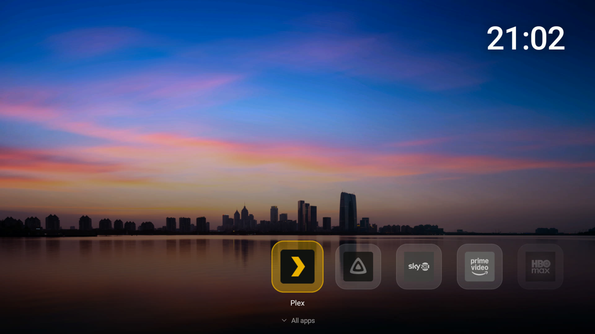

# Minimal Google TV

A calm, ad-free home screen for Google TV and Android TV, plus a careful cleanup of the apps you
don't need. You don't install anything by hand: you give [Claude Code](https://claude.com/claude-code)
the prompt in this repo, and it walks you through the whole thing, asking before every change.

Built on [tv-detox](https://github.com/Ansub/tv-detox) by Ansub Khan. `tv-detox-custom.patch` turns
its home screen into the one above.

## What you get

**Home screen**
- A full-screen nature photo from Windows Spotlight, with no text or credits on it. It changes every
  10 minutes; Settings > Next background changes it right away.
- A 24-hour clock at the top right, and nothing else: no ads, no recommendations, no rows of content.
- A favourites bar at the bottom, as a carousel: the selected app stays in the middle and the row
  slides along. Three apps show in full on each side, and the fourth one fades out.
- Glass tiles: every app is a rounded glass square with a grey icon. The selected one gets its own
  colours, grows a little, glows in the app's colour and shows its name.
- Hold OK on a favourite to move it, remove it or uninstall it.
- **All apps**: press Down for every installed app A to Z in a grid of eight across, with a Settings
  tile first. A dot marks your favourites. Hold OK to add or remove a favourite, or to uninstall.

**Fade to sleep**
- Your TV never goes dark without warning. At the screen saver time, whatever is on screen (like a
  paused show) slowly fades to black over 30 seconds, and then the TV sleeps.
- Press any key during the fade and you're right back where you were.

**Cleanup**
- Claude lists every app on your device in plain English, in three groups: safe to turn off, needed
  by the device, and apps you use. Nothing changes without your OK.
- Apps are turned off, not deleted, and each one is written to an undo list, both on the TV and in a
  folder on your computer.
- Animations are turned off, so menus feel faster.
- Claude restarts the device once at the end, checks that it starts up normally, and shows you free
  memory before and after.

**Undo**
- `sh undo.sh <ip>` turns every app back on, puts back the animation, screen saver and sleep settings,
  removes the new home screen and makes your device's own home screen the default again.

## What you need

- A Google TV or Android TV device on your Wi-Fi (tested on an NVIDIA SHIELD and a Xiaomi Mi Box S).
- A computer with [Claude Code](https://claude.com/claude-code) and Git.
- To build the home screen: the Android SDK and Java. On Windows also Git Bash and Python;
  Android Studio covers Java and the SDK.

## How to use it

1. Download this repo and keep `PROMPT.md` and `tv-detox-custom.patch` in the same folder.
2. Start Claude Code in that folder.
3. Paste everything below the line in `PROMPT.md`.

Claude asks for your device's IP address and your favourite apps along the way, and shows you
how to turn on debugging on the device.

## Before you start

This turns off system apps, and that carries some risk. A few devices got stuck at the logo or kept
restarting, Google TV devices like the Chromecast more often than others. Claude is an AI and can make
mistakes. The undo list and `undo.sh` turn everything back on.

When you're done, turn off USB, Network and Wireless debugging (or Developer options) on the device.
Only turn them back on for `undo.sh` or updates.

## License

MIT. See [LICENSE](LICENSE). tv-detox is MIT-licensed too, © Ansub Khan.
